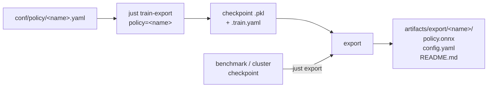

# Train and export a policy

One YAML defines a training run, `just train-export` trains it and writes a
deployable ONNX policy with a README holding everything needed to run it on
the robot. It sits beside the benchmark: `conf/train.yaml` defaults and the
benchmark runs are unchanged.



## 1. Define the policy

Copy the template and edit it:

```bash
cp conf/policy/template.yaml conf/policy/my_robot.yaml
```

`conf/policy/template.yaml` is a Hydra experiment config
(`# @package _global_`) that lists every value of `conf/train.yaml`
literally, the switches included; CLI value overrides still win. It gathers,
in one file:

| section | fields | notes |
|---|---|---|
| `defaults` | `override /robot`, `/mode`, `/level_space` | the option names; they must match the values below (`robot.name`, the `mode` switches, `level_space.kind`). A group choice on the CLI (`robot=go1`, `mode=sfl`) is refused by `train-export`: the file's values win over the option, so edit them (`mode.score=learnability` as a value override works) |
| robot | `robot.name` | wojtek, go1, barkour, spot, go2 |
| run | `name`, `seed`, `backend`, `num_timesteps`, `checkpoint_dir`, `export_dir`, wandb `entity` / `project` / `tags` | `name` names the wandb run, the checkpoint and `artifacts/export/<name>/` |
| training levels | `num_lanes`, `envs_per_lane`, `level_steps`, `min_travel`, `eval_*` | `level_steps` is a multiple of `ppo.unroll_length` |
| terrain | `arena.*`, `level_space.*` | difficulty envelope: `arena.amplitude`, `coarse_n`, `pad_*`, ..., `level_space.kind`, ACCEL edit strength |
| UED algorithm | `mode.*` | the switches `curriculum`, `mutation`, `score`, `generator`, `bc` (allowed options in the comments), then the numeric parameters (`replay_prob`, `buffer_size`, `generator_scale`, `grow_max`, PAIRED / BC settings) |
| PPO | `ppo.*` | `unroll_length`, `num_minibatches`, `num_updates_per_batch`, `discounting`, `gae_lambda`, `learning_rate`, `clipping_epsilon`, `max_grad_norm` |
| network | `network.*` | `policy_hidden`, `value_hidden`, `activation` (`elu`, `relu`, `tanh`, `swish`); the exported actor is the policy MLP |

- The template equals the benchmark `mode=accel` Wojtek config (a test keeps
  them equal); `ppo` and `network` default to the benchmark values in
  `conf/train.yaml`, so benchmark runs are bit-identical to before they were
  fields.
- Wojtek: the `accel` arena assets are built once with the same `arena.*`
  values (`just build-accel-arena arena.amplitude=...`); a mismatch fails at
  startup. Playground robots build their arena from the config.
- Playground robots run on `backend=jax`.
- The exported policy is only as good as its training: 300M steps is the
  benchmark's budget; use `num_timesteps=...` for a short run.

## 2. Train and export

```bash
just train-export policy=my_robot                       # defaults of the file
just train-export policy=my_robot seed=1 num_timesteps=50000000
WANDB_MODE=offline just train-export policy=my_robot    # keep the run local
```

- Trains locally (a GPU is used when present: `backend=auto`), writes
  `checkpoint_dir/<name>.pkl` and `<name>.train.yaml` (final training
  metrics), then exports to `export_dir/<name>/`.
- `just train-export` is `scripts/train_export.py` on `conf/train.yaml`: any
  override works, with or without `policy=`; `checkpoint_dir` must be set
  (the template sets `artifacts/checkpoints`).
- Smoke test on a laptop CPU (a few minutes, mostly jit):

```bash
JAX_PLATFORMS=cpu WANDB_MODE=offline just train-export policy=template \
  name=smoke num_timesteps=1500 num_lanes=2 envs_per_lane=16 level_steps=20 \
  eval_levels=2 eval_every=1 mode.buffer_size=8 backend=jax
```

## 3. Export an existing checkpoint

```bash
just export checkpoint=<run>.pkl policy=my_robot
```

- `scripts/export_policy.py` on `conf/export.yaml` (= `conf/train.yaml` +
  `checkpoint`, `config`). The training config is recovered one of three
  ways, all producing the same `TrainConfig`:

| how | example |
|---|---|
| a policy file | `policy=my_robot` (the file the checkpoint was trained from) |
| a config file | `config=<run dir>/.hydra/config.yaml` — the composed config Hydra wrote beside the run, or an export's `config.yaml`; it holds the mode, so no `mode=`; its values replace the composed ones, except `checkpoint_dir` and `export_dir`, which stay those of this machine's command line; fields it lacks (runs older than `ppo` / `network`) keep the `conf/train.yaml` values |
| overrides | `mode=accel robot=go1 seed=0 name=<run>`: benchmark runs are the `conf/train.yaml` defaults plus their overrides (`.hydra/overrides.yaml` beside the run lists them) |

- Benchmark checkpoint from the cluster: copy `artifacts/brax_ued/<run>.pkl`
  (and `<run>.train.yaml` if present, for the README's training metrics) and
  `artifacts/hydra/<run>/` to the laptop, then
  `just export checkpoint=<run>.pkl config=artifacts/hydra/<run>/.hydra/config.yaml`.
- The export builds its env on jax whatever `backend` the run trained on:
  the inference graph has no physics, and warp may be absent here.
- Without `config=` and `policy=` the mode must be given (`mode=<name>`);
  the export fails with the three options otherwise.
- The checkpoint must match the config: a different robot, observation
  layout or network fails with the sizes that disagree, before anything is
  written. Pass the `network.*` the run trained with.
- Without `<run>.train.yaml` beside the checkpoint the README says its
  training metrics were not recorded.

## 4. Train on the cluster

Cluster-specific values (`#SBATCH` lines, `REPO`, `PDW`, `WB_*`) as in
[slurm.md](slurm.md#cluster-specific-values); the repo, `.venv` and the built
assets must already be on the cluster.

```bash
#!/bin/bash
#SBATCH --job-name=wued-policy
#SBATCH --account=<grant>
#SBATCH --partition=lem-gpu-short
#SBATCH --gres=gpu:hopper:1
#SBATCH --cpus-per-task=4
#SBATCH --mem=96gb
#SBATCH --time=16:00:00
#SBATCH --output=<logs>/%x_%j.out
# usage: POLICY=my_robot sbatch policy.sbatch   (conf/policy/my_robot.yaml)
set -euo pipefail

REPO="$HOME/workspace/ml-wojtek-ued"
PDW=<work dir on the parallel disk>
WB_ENTITY=<wandb entity>

export PYTHONNOUSERSITE=1 PYTHONUNBUFFERED=1 HYDRA_FULL_ERROR=1
export JAX_PLATFORMS=cuda XLA_PYTHON_CLIENT_PREALLOCATE=false
export PYTHONPATH="$REPO/src"
cd "$REPO"

uv run --no-sync python src/scripts/train_export.py "policy=${POLICY:?set POLICY}" \
  "entity=$WB_ENTITY" "checkpoint_dir=$PDW/artifacts/checkpoints" \
  "export_dir=$PDW/artifacts/export"
```

- The job exports at the end; copy `$PDW/artifacts/export/<name>/` to the
  laptop (`rsync`), or copy `<name>.pkl` + `<name>.train.yaml` and run
  `just export` there.

## 5. What comes out

`artifacts/export/<name>/` holds exactly three files:

| file | content |
|---|---|
| `policy.onnx` | the deterministic actor, opset 17 (IR 8), no sampling |
| `config.yaml` | the full composed training config |
| `README.md` | the deployment contract, generated from the env and the config |

`policy.onnx`:

- input `obs` float32 `[batch, obs_dim]`: the raw actor observation; the
  training-time running mean / std are in the graph.
- output `action` `[batch, 12]`: `tanh(mean)` of the policy head, in [-1, 1].
- output `joint_targets` `[batch, 12]`: rad, what the env hands to the PD
  controllers. Per robot, read from the env:
  - Playground robots: `clip(default_pose + action_scale * action, lo, hi)`
    (`lo` / `hi`: the env's explicit clip for Barkour and Spot, the
    actuator control range where the model has one).
  - Wojtek: `clip(stance(height) + action_scale * action, lo, hi)`; the
    zero-action stance follows the commanded height (`command[3]`) through
    the env's settled-pose table, interpolated inside the graph.
- Wojtek's env low-passes the action (`action_filter`) before the targets;
  the filter is state, so it is not in the graph. The README's control loop
  applies it and corrects `joint_targets`; exact unless a target sits on its
  limit.
- `phase` (Wojtek's gait clock) is not a sensor: the README gives the clock.
- `config.yaml` re-exports the checkpoint (section 3).

### The README

Generated by `export/readme.py` from a `Contract` that `export/contract.py`
builds from the live env (sizes, joint names, kp / kd, defaults, action
scale, target limits, `ctrl_dt`, command ranges, noise) — nothing is typed
in. Sections:

| section | content |
|---|---|
| Inputs | each obs component: name, index range, size, units, what to read on the robot, training noise |
| Outputs | `action`, `joint_targets` |
| Joints and gains | joint order, default pose, target limits, kp / kd, torque limit, `action_scale` |
| Joint targets | the mapping above, Wojtek stance table and action filter |
| Commands | command order, units, trained ranges (`vx`: the envelope of every draw), the draw mixture (stand, arc, slow, fast, ...) and resample period |
| Gait clock | Wojtek: the phase clock as code, with the env's constants |
| Usage | `onnxruntime` control-loop sketch |
| Training conditions | noise, action filter / delay, latency, encoder offset, pushes |
| Training metrics | final reward per step, train success, falls per step, forward velocity vs commanded vx, env steps, wall time: means over the last 10 training iterations, not an evaluation |
| Verification | the export-time check |

### Robots

| robot | `obs_dim` | actor observation (in order) | caveat |
|---|---|---|---|
| `wojtek` | 54 | gyro 3, gravity 3, joint_pos 12, joint_vel 12, last_act 12, command 4 (vx, vy, wz, height), phase 8 | needs the gait clock and the action filter |
| `go1`, `go2` | 48 | linvel 3, gyro 3, gravity 3, joint_pos 12, joint_vel 12, last_act 12, command 3 | `linvel` needs a state estimator |
| `spot` | 81 | gyro 3, gravity 3, joint_pos 12, qpos_error_history 36, feet_pos 12, last_act 12, command 3 | `feet_pos` from forward kinematics |
| `barkour` | 465 | 15 frames x (gyro_z 1, gravity 3, command 3, joint_pos 12, last_act 12), newest first | frame history kept by the control loop |

Wojtek's components are the env's `obs.state` list with the sizes of its
observation catalog. The Playground robots' layout is measured on the env
(`export/playground_obs.py`): each input signal (a sensor getter, the joint
angles, an `info` entry) is shifted in turn, and the observation entries
that move are that component's slice, their change its scale (Barkour's
`0.25 rad/s`). A swap of same-size components in the env therefore changes
the contract; entries no channel explains fail the export (update the
channels in `export/playground_obs.py`).

## 6. Use it on the robot

1. Read the generated `README.md`: the joint order and the sensor
   conventions (IMU frame, encoder zero = the default pose) are the
   robot-specific part.
2. Run at `ctrl_dt` with the same PD gains (kp / kd) and torque limit as the
   Joints table.
3. Command inside the trained ranges of the Commands table.
4. Wojtek: run the gait clock and the action filter from the README.
5. Compare against the simulation first: sim2sim ([evaluation.md](evaluation.md))
   scores a benchmark checkpoint on CPU MuJoCo variants.

## Verification

At every export, before writing:

- onnxruntime (CPU) is compared with the JAX policy
  (`default_matmul_precision=highest`) and the env's own action-to-target
  code (`FunctionalEnv.base`): 256 random observations (normal around the
  normalizer's mean / std, and uniform in [-1, 1]) and 400 observations from
  the policy walking real levels of the config's arena.
- both outputs must agree to `max |error| <= 1e-5`; otherwise the export
  fails and nothing is written. The measured errors are in the README.
- the contract is checked against the env's actor observation size.

## Code

| path | role |
|---|---|
| `src/export/contract.py` | `Contract` of a robot, built from the env |
| `src/export/playground_obs.py` | Playground robots: actor observation layout measured on the env |
| `src/export/onnx_graph.py` | ONNX graph from the checkpoint params |
| `src/export/verify.py` | onnxruntime vs JAX |
| `src/export/readme.py` | README text |
| `src/export/run.py` | `export_policy`, config recovery |
| `src/training/summary.py` | `<name>.train.yaml`: final training metrics |
| `src/scripts/train_export.py`, `export_policy.py` | entry points |

`onnx` and `onnxruntime` are pinned dependencies: `onnx` builds and checks
the graph, `onnxruntime` runs the export-time check (and is what the robot
runs).
