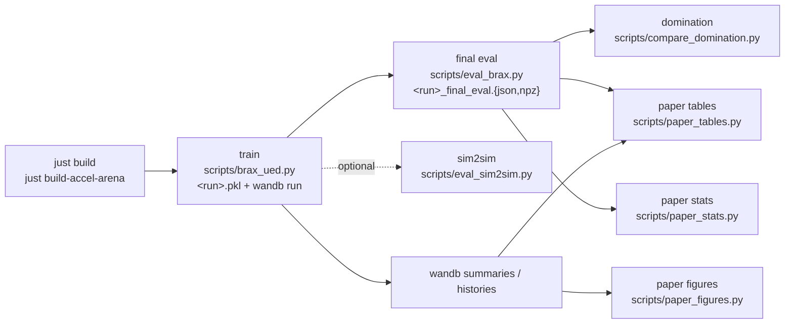

# Overview

Quadruped UED Benchmark: Unsupervised Environment Design (UED) for quadruped
locomotion on procedural terrain. A brax-PPO student trains against a
curriculum that generates, replays or edits heightfield levels. 12 curricula
(`conf/mode/`) x 5 robots (`conf/robot/`), every level of an iteration on its
own tile of one shared MJX heightfield. Commands to reproduce the paper:
[README](../README.md#reproduce-the-paper).

## Pipeline



- Run name `<prefix>_<robot>_<mode>_seed<N>` (prefix `ued`); eval dumps
  `<run>_final_eval`. The paper scripts read `prefixes.<robot>`
  (default `ued_<robot>`). Commands: [README](../README.md#reproduce-the-paper).

## Methods

`mode=<option>` selects a curriculum (`conf/mode/`).

| `mode=` | curriculum | citation |
|---|---|---|
| `dr` | fresh uniform levels at full difficulty | domain randomization (Tobin et al. 2017) |
| `dr_easy` | DR over the easy generator (control points within `generator_scale` of flat) | ablation: "train easy" without a curriculum |
| `dr_mixed` | uniform levels scaled by a per-level difficulty `U(0, 1)` | ablation |
| `plr` | robust PLR (PLR⊥): rank + staleness replay of high-regret levels, explore iterations score fresh DR levels without training | Jiang et al. 2021 (PLR; Replay-Guided Adversarial Environment Design) |
| `sfl` | PLR⊥ scored by learnability `p(1-p)` | approximation of SFL (Rutherford et al. 2024) |
| `accel` | PLR⊥ buffer + mutation of replayed levels; explore iterations score children + fresh easy levels | ACCEL (Parker-Holder et al. 2022) |
| `accel_grow` | ACCEL, mutation also scales the level away from flat by `U(1, grow_max)` | ablation |
| `accel_sfl` | `accel_grow` scored by learnability | ACCEL + SFL score |
| `paired` | learned level generator, protagonist + antagonist, PAIRED regret | PAIRED (Dennis et al. 2020) |
| `paired_uni` | PAIRED + UniBC (protagonist distils the antagonist) | Mediratta et al. 2023 (Stabilizing UED with a Learned Adversary) |
| `paired_bi` | PAIRED + BiBC (both directions) | Mediratta et al. 2023 |
| `paired_evo` | ACCEL's buffer and mutation scored by PAIRED regret, two students | PAIRED regret + ACCEL editing |

- Level score: positive value loss = mean positive GAE advantage of a lane
  (`plr`, `accel`, `accel_grow`); learnability (`sfl`, `accel_sfl`); PAIRED
  regret (`paired*`). The `dr*` modes score nothing.
- Details and switches: [training.md](training.md#trainer), [PAIRED](training.md#paired).

## Robots

`robot=<option>` (`conf/robot/`).

| `robot=` | model | `SCALE` | physics DR |
|---|---|---|---|
| `wojtek` | W01-TEK (closed-chain legs, `wojtek_env`) | 1.0 | `wojtek_env` baseline |
| `go1` | Unitree Go1 (Playground) | 2.5 | Playground Go1 |
| `barkour` | Google Barkour vB (Playground) | 2.5 | none |
| `spot` | Boston Dynamics Spot (Playground) | 4.3 | none |
| `go2` | Unitree Go2 (Go1's env on the menagerie model) | 2.7 | Go1's |

- `SCALE` = standing trunk height / Wojtek's 0.10 m; scales arena lengths,
  level lengths, commands and `min_travel` (slopes do not scale). Spot's
  levels are 780 steps, not 300: [robots.md](robots.md).
- Details: [robots.md](robots.md).

## Export

`just train-export policy=<name>` / `just export checkpoint=<pkl>`: one YAML
(`conf/policy/`) defines a run; the result is `artifacts/export/<name>/`
(`policy.onnx`, `config.yaml`, a generated `README.md`).
[export.md](export.md).

## Level space

`level_space=param` (default; `conf/level_space/`).

- 8 parameters in `[0, 1]` + a never-mutated noise seed; ranges in Wojtek
  units: rough amplitude 0–0.10 m / wavelength 0.2–1.0 m, radial slope
  −20…+18°, radial stairs −0.08…+0.05 m high / 0.15–0.60 m wide, gaps
  0–0.06 m wide, blocks 0–0.06 m high / 0.15–0.60 m wide.
- Rendered onto a 6 m x 6 m patch (`arena=benchmark`, amplitude ±0.3 m,
  flat spawn pad 0.55 m), one level per tile of a 16 x 16 arena.
- `level_space=grid` (13 x 13 control-point genome) is the other option.
- Details: [levels.md](levels.md#level-spaces).

## Metrics

Computed by `eval_brax.py`.

- **Success**: no fall and >= `min_travel` (1 m x `SCALE`) from spawn after
  300 steps (6 s; Spot 780, 15.6 s); deterministic policy, no physics DR.
- **Sets**: `param/uniform` (2048 levels from the full box, headline),
  `random/d<d>` (difficulty 0.25/0.5/0.75/1.0), `suite/*` (28 held-out
  structured terrains), `flat`, `axis/<feature>` capability ramps.
- **CVaR10 / CVaR25**: mean success of the worst 10 / 25 % of levels,
  cross-fitted over two independent passes.
- **Solvable subset** (`paper_tables`): `param/uniform` levels some run of the
  robot passes, cross-fitted.
- **Axis envelope**: largest feature magnitude passed at 50 % success.
- **Domination** (`compare_domination`): per-level solve rates of two
  methods, `a_better` / `b_better` / ties, mean difference with bootstrap
  CI, binomial noise reference, method x method matrix.
- 95 % bootstrap CIs over levels. Details:
  [evaluation.md](evaluation.md#final-eval).

## Two layers

| Layer | Location | Role | Tooling |
|---|---|---|---|
| Env library | `src/wojtek_env/` | Wojtek MJX env, procedural terrain, Gymnasium wrapper, build/check CLIs | hatchling-packaged, excluded from ruff |
| Research code | `src/{config,env,robots,hfield,training,evaluation,rendering,paper,diagnostics,scripts}/` | trainer, curricula, levels, eval, paper tooling | ruff + ty |

`src/wojtek_env/` is extracted from the W01-TEK robot stack and treated as a
stable dependency (env only). Details: [environment.md](environment.md).

## Repo map

```
src/
  wojtek_env/        env library (see environment.md)
    envs/            MJX envs: joystick, getup, jump  (registry.make_env)
    terrain/         procedural terrain generator + curriculum wrapper
    gymnasium/       WojtekGymEnv
    tools/           build_model / build_terrain / check_* CLIs
    paths.py         repo-relative asset paths, robot constants
  config/            Hydra structured configs  (see configuration.md)
    hfield_config.py HFieldConfig (level envelope, the `arena` group)
    schema.py        schema dataclass per entry point, enums, CONF_DIR
  env/               Wojtek / Playground robots as jit/vmap training envs
    functional.py    FunctionalEnv: pure reset/step on the shared arena; Obs
    factory.py       make_env (Wojtek or a Playground robot), check_wojtek_arena
    overrides.py     shared env override dicts (movement / terrain / arena)
    travel.py        TravelBounds: how far an env can read terrain per level
    divergence.py    end_diverged: end episodes whose physics blew up
    height_lookup.py Wojtek's terrain lookup rebuilt from hfield_data
    warp.py          warp backend memory checks and graph cache
  robots/
    terrain.py       TerrainRobot: arena scene, spawn, fall, scan, commands
    go1.py barkour.py spot.py go2.py   one file per Playground robot
    registry.py      TERRAIN_ROBOTS: robot name -> class
    scale.py         robot_scale, pd_gains, hfield_config, min_travel (robot.* overrides)
  hfield/            heightfield levels  (see levels.md)
    manager.py       HFieldManager: generate / mutate / upsample a grid level
    level_space.py   level spaces (`param`, `grid`)
    arena.py         write the static tiled "accel" MJCF arena assets
    tiles.py         TileLayout: one level per tile of the shared arena
  training/          the trainer behind scripts/brax_ued.py
    ppo.py           brax PPO networks (hyperparameters: `ppo` / `network` config)
    student.py       Student: params, optimizer, jitted update / regret / BC KL
    unroll.py        jitted policy rollout on the shared arena
    context.py       TrainContext (everything build makes), KeyStream
    build.py         build a TrainContext from TrainConfig, check_config
    iteration.py     run_levels: one outer iteration over the lanes
    curricula.py     DR / ACCEL / PLR / PAIRED / PAIRED+Evo iterations
    buffer.py        LevelBuffer (rank + staleness replay)
    adversary.py     PAIRED adversary (single-step PPO on regret)
    generator.py     LevelGenerator network (PAIRED adversary policy)
    paired.py        PAIRED regret, student BC KL, BC weights
    evaluate.py      in-training eval on uniform levels
    metrics.py       level composition of the levels trained on
    train.py         the train loop: wandb, logging, checkpoint
    summary.py       final training metrics beside the checkpoint
  export/            checkpoint + config -> ONNX policy + deployment README
    contract.py      obs layout, joints, gains, commands, built from the env
    onnx_graph.py    the deterministic actor as an ONNX graph
    verify.py        onnxruntime vs JAX at export
    readme.py        the generated README
    run.py           export_policy: the three output files
  evaluation/        behind eval_brax / eval_sim2sim / compare_domination
    rollout.py       EvalContext, chunked deterministic rollouts
    suite.py         held-out structured terrain suite
    stats.py         cross-fitted CVaR, bootstrap CIs, capability envelopes
    final_eval.py    eval_brax's level sets and metrics
    physics_variants.py  sim2sim's CPU MuJoCo model transforms
    cpu_physics.py   CpuPhysics: CPU MuJoCo stepping under the jax env
    sim2sim.py       sim2sim's level sets, metrics, build
    domination.py    level-by-level method comparison (solve rates, stats)
  rendering/         one-tile render model, mp4 clips (render_video)
  paper/
    runs.py          eval/run loading, solvable subset, wandb summaries
    labels.py        robot / method labels
    latex.py         booktabs cells and tabulars
    tables.py        main / envelopes / compute tables, CSV
    figures.py       curves and composition figures
    domination.py    domination heatmaps and matrices
    terrains.py      rendered example levels
  diagnostics/
    arena_check.py   per-backend shared-arena check (check_hfield_batch.py)
    throughput.py    throughput profile of a training iteration (`just profile`)
  scripts/           thin Hydra entry points (`just` recipes, slurm/)
    brax_ued.py          train                       (`just train`)
    eval_brax.py         final eval of a checkpoint  (`just eval`)
    eval_sim2sim.py      CPU MuJoCo variants         (`just sim2sim`)
    render_video.py      mp4 clips of a checkpoint   (`just render-video`)
    paper_tables.py / paper_figures.py               (`just paper-*`)
    compare_domination.py  domination comparison     (`just domination`)
    train_export.py      train, then export          (`just train-export`)
    export_policy.py     export a checkpoint         (`just export`)
    profile_brax_ued.py  throughput profile          (`just profile`)
    check_hfield_batch.py  shared-arena check
conf/                Hydra YAML: one primary per entry point + groups
                     robot/ mode/ level_space/ arena/ network/ policy/
                     (see configuration.md)
slurm/               SLURM job arrays: train, final eval, sim2sim, assets
                     (see slurm.md)
tests/               pytest, mirrors src/
docs/                this documentation (see index.md)
```

## Glossary

- **Level / genome** — the `param` vector (or `grid` control points) in
  `[0, 1]`, rendered to a heightfield patch on its tile of the arena.
- **Lane** — one level of an iteration and its `envs_per_lane` envs.
- **Regret** — positive value loss: how much the critic under-estimated the
  return on a level. PAIRED: antagonist max return − protagonist mean.
- **Student** — the brax PPO policy; the protagonist under PAIRED.
